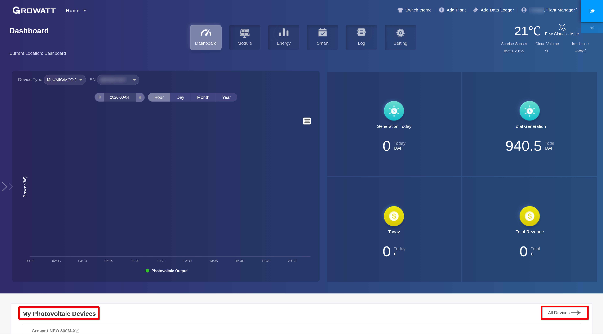
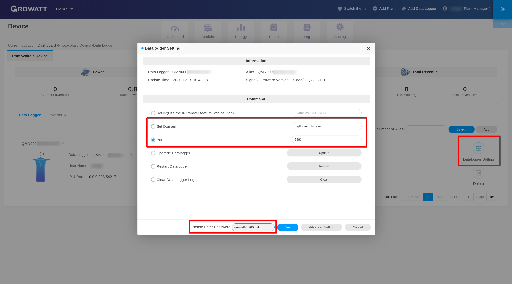
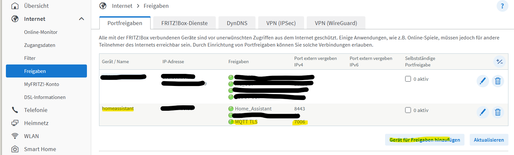
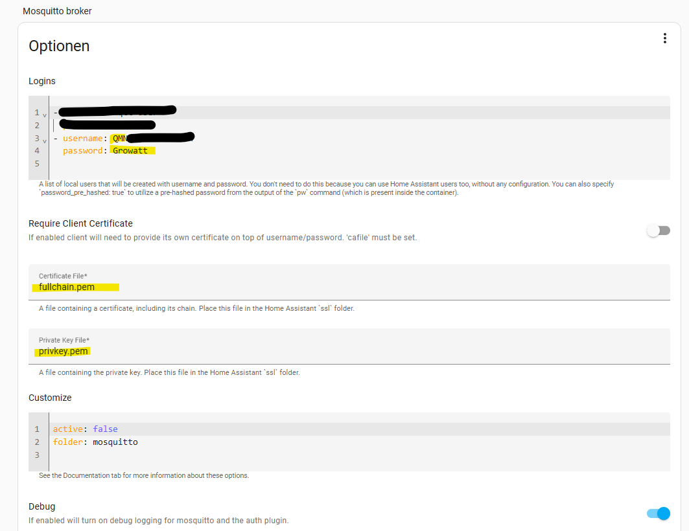
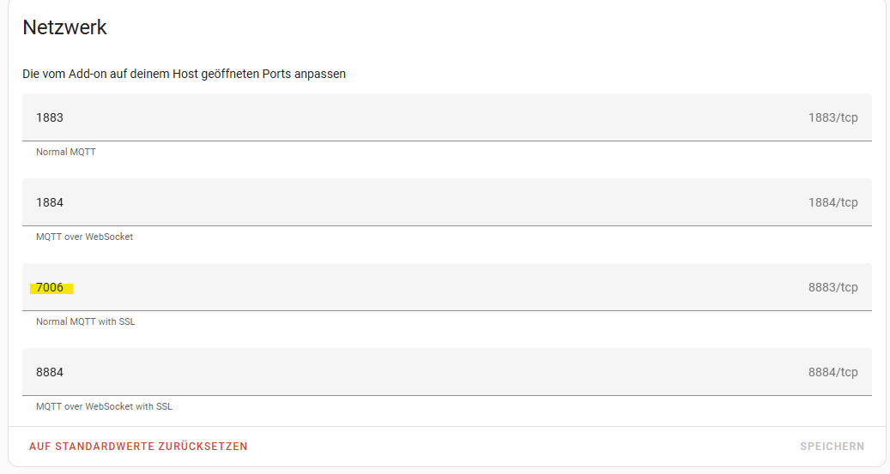
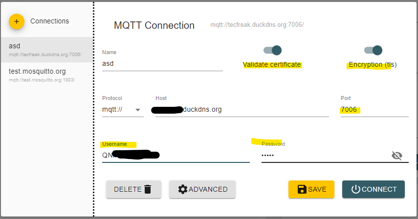

# Configuration

This guide sets up a dedicated Mosquitto instance with TLS for your Growatt devices and runs GroBro as container. If you use the Home Assistant add-on, configure the same options in the add-on UI instead of step 5. For a setup based on the Home Assistant Mosquitto add-on see [Example Setup with DuckDNS and HA-MQTT](#example-setup-with-duckdns-and-ha-mqtt).

## Setup

### 1. Prerequisites

You have a valid Let’s Encrypt certificate.

You have the following files:
- `fullchain.pem` – contains server + intermediate certificates
- `privkey.pem` – your private key

These are usually located in `/etc/letsencrypt/live/<your-domain>/`

Growatt devices need the full trust chain including the root. Check which root your certificate chains to in the [Certificates Guide](CERTIFICATES.md), for an ISRG Root X2 chain it looks like this:
```bash
curl -o root.pem https://letsencrypt.org/certs/isrg-root-x2.pem
cat fullchain.pem root.pem > chain-full.pem
```

So now you have:
- `chain-full.pem` (cert chain including ISRG Root X2 certificate)
- `privkey.pem` (private key)

### 2. Mosquitto TLS Configuration

Create a Mosquitto config file:
```
# Listener on port 7006 for TLS
listener 7006

# Path to certs and key
certfile /mosquitto/certs/chain-full.pem
keyfile /mosquitto/certs/privkey.pem
cafile /mosquitto/certs/root.pem

# Allow anonymous connections
allow_anonymous true
```

### 3. Run the Mosquitto TLS Container

Make sure your volume mounts place the certs and config properly:
```
/mosquitto
├── config
│   └── mosquitto.conf
├── certs
│   ├── chain-full.pem
│   ├── privkey.pem
│   └── root.pem
```

Now run the Mosquitto container like this and check the logs for any errors:
```bash
docker run --detach \
  --name mosquitto-tls \
  --publish 7006:7006 \
  --volume ./mosquitto-tls/conf:/mosquitto/config \
  --volume ./mosquitto-tls/data:/mosquitto/data \
  --volume ./mosquitto-tls/certs:/mosquitto/certs \
  docker.io/library/eclipse-mosquitto:latest
```

### 4. Setup the Growatt Device

There are two ways to point your device to your own MQTT server. In both cases you need the password, which is based on the current date:

`growatt<YYYYMMDD>`

#### Option A: ShinePhone app (Bluetooth)

The ShinePhone app connects to the device via Bluetooth, so you need to be close to it.

- **NEO and NOAH:** Open the device settings, tap `Wifi configuration` -> `Configuration` -> `Connect device` and open the `Advanced` settings.
- **NEXA:** Go to `Grohome`, tap `+` in the upper right corner -> `Add device` -> `Balcony storage` -> `Nexa` and select the device you want to reconfigure. Open the `Advanced` settings.

Replace `mqtt.growatt.com` with the address of your Mosquitto instance configured for TLS and set the port.

#### Option B: openapi.growatt.com

Open the [openapi.growatt.com](https://openapi.growatt.com) dashboard. Configuration cannot be performed at night when the inverter is off and not connected to the internet.



Click `All Devices` in the `My Photovoltaic Devices` section. After that select the device you want to reconfigure and click `Datalogger Setting`.



First enter the password. Only when entered correctly the settings can be modified. Select `Set Domain`, enter the hostname of your Mosquitto instance configured for TLS and save. Then select `Port`, enter the port and save again. Domain and port have to be saved separately, and it may take several attempts until the device picks up the new settings.

Additionally: Block the device from accessing the internet after configuration to prevent it from reverting settings or syncing with the cloud.

### 5. Run the GroBro HA Bridge

This example demonstrates how to run the GroBro HA bridge with a dedicated TLS-secured Mosquitto instance for the Growatt device as the source, and a separate MQTT broker for Home Assistant as the target:
```bash
docker run --detach \
  --name grobro-bridge \
  --env SOURCE_MQTT_HOST=<source-mqtt-host> \
  --env SOURCE_MQTT_PORT=<source-mqtt-port> \
  --env SOURCE_MQTT_TLS=true \
  --env TARGET_MQTT_HOST=<target-mqtt-host> \
  --env TARGET_MQTT_PORT=<target-mqtt-port> \
  ghcr.io/robertzaage/grobro:latest
```

## Environment Variable Reference

The container is configured via environment variables. The Home Assistant add-on exposes the most common ones in its configuration UI, options marked with ⚙️ are only available as environment variables for now.

| Variable | Required | Default | Description |
|---|---|---|---|
| `SOURCE_MQTT_HOST` | ✅ | `localhost` | Hostname or IP of the source MQTT broker your Growatt devices connect to |
| `SOURCE_MQTT_PORT` | ✅ | `1883` | Port of the source MQTT broker |
| `SOURCE_MQTT_TLS` | | `false` | Set to `true` to connect to the source broker via TLS |
| `SOURCE_MQTT_TLS_VERIFY` ⚙️ | | `false` | Set to `true` to verify the certificate and hostname of the source broker. Requires TLS, see [below](#optional-mqtt-tls-verification) |
| `SOURCE_MQTT_CA_FILE` ⚙️ | | | Optional PEM CA bundle inside the container. Requires TLS verification |
| `SOURCE_MQTT_USER` | | | Username for the source broker |
| `SOURCE_MQTT_PASS` | | | Password for the source broker |
| `TARGET_MQTT_HOST` | ✅ | source host | Hostname or IP of the target MQTT broker used by Home Assistant |
| `TARGET_MQTT_PORT` | ✅ | source port | Port of the target MQTT broker |
| `TARGET_MQTT_TLS` | | source setting | Set to `true` to connect to the target broker via TLS |
| `TARGET_MQTT_TLS_VERIFY` ⚙️ | | `false` | Same as `SOURCE_MQTT_TLS_VERIFY` for the target broker, not inherited from the source |
| `TARGET_MQTT_CA_FILE` ⚙️ | | | Same as `SOURCE_MQTT_CA_FILE` for the target broker, not inherited from the source |
| `TARGET_MQTT_USER` | | source user | Username for the target broker |
| `TARGET_MQTT_PASS` | | source password | Password for the target broker |
| `HA_BASE_TOPIC` | | `homeassistant` | Base topic for Home Assistant auto-discovery and states |
| `MQTT_CLIENT_SUFFIX` ⚙️ | | | Suffix for the MQTT client IDs, allows running multiple GroBro instances against the same broker (e.g. prod and test) |
| `GROWATT_CLOUD` | | `false` | Set to `true` to forward messages to and from the Growatt Cloud, so the ShinePhone app keeps working. A comma-separated list of serials (e.g. `QMN000ABC1D2E3FG,0PVP0000TEST0001`) only forwards these devices |
| `GROWATT_CLOUD_CONFIG_FILTER` | | `false` | Set to `true` to stop forwarding config messages, so the Growatt Cloud can't change datalogger settings |
| `DEVICE_TIMEOUT` | | `0` | Seconds without data until a device is considered offline. `0` disables availability tracking, `300` or more is recommended |
| `AVAILABILITY_SENSOR` | | `false` | Requires `DEVICE_TIMEOUT`. Set to `true` to get a dedicated `Online` sensor instead of marking all entities as unavailable |
| `MAX_SLOTS` | | `1` | Number of time slots shown for NOAH and NEXA (up to 9) |
| `MAX_BAT` | | `auto` | Number of battery packs shown in Home Assistant. `auto` uses the battery count reported by the device; while GroBro runs it only ever grows, so a disconnected battery keeps its entities. Set a number (e.g. `1`) to override, which also removes the entities of batteries above it |
| `FILTER_DATA_GLITCHES` | | `false` | Set to `true` to suppress energy counters dropping after a device reconnects |
| `KEEP_BATTERY_POSITION` | | `false` | Set to `true` to log a warning when a NOAH battery moves to a different position in the stack |
| `PUBLISH_SENSORS_RETAINED` | | `false` | Set to `true` to publish sensor states with the MQTT retain flag, so Home Assistant gets the last state right after its own restart instead of showing "unknown" until the device sends new data |
| `TZ` | | | Time zone (e.g. `Europe/Berlin`) used by the `Sync Time` button |
| `LOG_LEVEL` | | `ERROR` | `ERROR`, `INFO` or `DEBUG` |
| `DUMP_MESSAGES` | | `false` | Set to `true` to save every received message to `DUMP_DIR` for in-depth inspection |
| `DUMP_DIR` | | `/dump` | Directory for dumped messages (`/share/GroBro/dump` in the add-on) |

## Optional MQTT TLS verification

GroBro connects to your brokers via TLS without verifying their certificates by default. You can enable verification independently for the source and target brokers:

```yaml
# Docker Compose environment example
environment:
  SOURCE_MQTT_HOST: mqtt.example.com
  SOURCE_MQTT_PORT: "7006"
  SOURCE_MQTT_TLS: "true"
  SOURCE_MQTT_TLS_VERIFY: "true"
```

Use a hostname matching the broker certificate. When no CA file is specified,
Python uses the container's default trusted CA store. For a private CA, mount its
PEM trust bundle read-only and set `SOURCE_MQTT_CA_FILE` to the path inside the
container. The target broker has the equivalent `TARGET_` options. Verification
and CA settings are independent and are not inherited from the source broker.
A CA file replaces the default trust store for that connection.

Verification is disabled by default for compatibility. When enabled, an invalid
certificate, hostname mismatch or unreadable CA file fails the connection/setup;
there is no automatic insecure fallback. Verification with TLS disabled, or a CA
file without verification, is rejected. The Growatt cloud forwarding connection
and inverter-to-broker TLS behavior are unchanged. These options are not yet
exposed through the Home Assistant add-on configuration UI.

## Example Setup with DuckDNS and HA-MQTT

### 1. Set up DynDNS Address and Certificates
There are many guides available on how to do this. I use a DuckDNS address and the DuckDNS add-on to create the certificates. Just follow their guide. Your certificate should then be located at `/ssl/fullchain.pem` and your key at `/ssl/privkey.pem`.

### 2. Open Port in Your Router and Redirect to Home Assistant
If you completed step 1, you should already know how to do this. Open port **7006** and redirect it to your Home Assistant instance. Example on a FritzBox:


(It might also be possible to use the default MQTT TLS port **8883**. In that case, you must also change the port on your device as described in [step 4](#4-setup-the-growatt-device) above. Alternatively, you can open external port **7006** and redirect it internally to **8883** — there are many ways to set it up 😉.)

### 3. Set up HA-MQTT
You just need to create a new user.
The username must be the serial number of your inverter. (If you are unsure, enable debug logging and check the logs while reconfiguring your inverter or Noah. You should see a line like `"checking auth cache for <username>"` in the logs.)

The password is **Growatt**.

Make sure the certificate names from step 1 are correctly configured:


Start your MQTT server on port **7006** (or on the default TLS port, as described above):


### 4. Check If Everything Works
You can use MQTT Explorer (https://github.com/thomasnordquist/MQTT-Explorer) for this.  
Make sure that **Validate certificate** and **Encryption** are enabled.  
If you can log in, everything is working correctly!


### 5. Optional: DNS Rewrite
To stay fully local, you can set up a DNS server (like AdGuard) to rewrite your `*.duckdns.org` address to the IP of your Home Assistant instance. The certificates will remain valid.


## Hardware Safety & Best Practices (NEXA 2000 & NOAH 2000)

### 1. High-Frequency Modbus Writing (Shadow RAM)
A common concern for users creating dynamic "Zero Export" automations in Home Assistant is that updating power limits every few seconds might destroy the device's Flash/EEPROM memory. 

According to internal Growatt R&D information, **high-frequency Modbus writes for dynamic power control are 100% hardware-safe**, provided you use the Time Slot registers. 

Both the Nexa 2000 and NOAH 2000 utilize a highly optimized **"Shadow RAM / Lazy Write"** mechanism. When GroBro sends a Modbus write command to the power settings, the MCU immediately applies this value to the volatile RAM, adjusting the output instantly *without* triggering physical EEPROM erase/write cycles. The system only commits these RAM values into the non-volatile EEPROM during a graceful system shutdown. Therefore, updating parameters like `slot1_power` every 30 seconds generates literally zero wear on the flash memory over the lifetime of the device.

### 2. Recommended "Zero Export" Setup via Home Assistant
To ensure a reliable and clean local control loop without relying on cloud APIs, the following setup is highly recommended by Growatt engineers for HA users:

**The Fail-Safe Baseline (Do this once):**
*   Set `default_power` (Reg 322) to a conservative, fixed value (e.g., 100W or 150W). 
*   *Why?* Because dynamic values are only stored in RAM, a sudden power loss will wipe them. If the device reboots and Home Assistant is offline, the inverter will safely fall back to this basic household load baseline stored in the EEPROM.

**Configure Static Slot Parameters (Do this once):**
To keep Modbus traffic clean and reduce unnecessary bus load, configure the static parameters on Slot 1 just once:
*   `slot1_start_time` (Reg 254) = 00:00
*   `slot1_end_time` (Reg 255) = 23:59
*   `slot1_mode` (Reg 256) = 0 (Load First)
*   `slot1_enabled` (Reg 258) = 1 (ON)

**The Dynamic Control (Automation Loop):**
*   Let your Home Assistant automation continuously update **only** `slot1_power` (Reg 257) based on your local smart meter readings.
*   NEXA only: Values above 800W require the `Power+` switch (Reg 325) to be enabled, otherwise the device rejects them.

### 3. Important Safety Warning Regarding AC Charging (Nexa 2000)
Currently, dynamic adjustment of AC charging power (up to 700W) is handled entirely internally by the MCU via a closed-loop algorithm based on grid conditions. **There is no exposed Modbus register for third-party control over the AC charging limit.** 

*   Do **not** attempt to reverse-engineer or force write custom values to the charging controller limits. 
*   Accidentally bypassing the native BMS and charging electronics limits can result in catastrophic hardware failure, severe thermal runaway, or an explosion/fire hazard. Let the native electronics make the final call on charging. 

*(Note: The technical insights in this section were provided by a Growatt employee acting out of personal enthusiasm for the Home Assistant community. Growatt does not officially support this project at this time, and these insights do not represent official company directives).*

### 4. NEO Inverter Power Switch (Register 0)
The NEO holding-register map exposes an **Inverter Power** switch on register 0 (function `0x06` Modbus write, value `0x0000` = OFF, `0x0001` = ON). This is the same command Growatt's cloud sends when the user taps on/off in ShinePhone, and it works against the local broker without an active cloud session.

Use it when you need a true off — the existing `output_power_limit` (Reg 3) enforces a hardware floor of ~30 W at 0 %, so it can't fully stop AC output. The on/off switch can.

Caveats:
*   EEPROM-wear characteristics of register 0 are not documented. Until verified, treat it as a coarse-grained control: occasional automation triggers (e.g., negative grid pricing, export caps), not high-frequency dynamic control. Use `output_power_limit` for continuous setpoint loops.
*   After an OFF, the inverter takes several seconds to actually drop AC output (cloud-style command propagation delay). The HA-side `Inverter_Status` sensor (`StandbyStatus`/`NormalStatus`) reflects the real state.
